# 🛡️🚀 Secure AWS Architecture & Automated Multi-OS Observability 🚀🛡️

**From secure web delivery to automated deployments and monitoring: a hands-on AWS, DevOps, and Site Reliability Engineering proof of concept.**

> **10 monitored EC2 instances** (5 Windows Server + 5 Ubuntu) · **2 web deployment approaches** (Ansible/Apache/Jinja2 and Docker/Nginx) · **Datadog observability** · **Terraform-managed monitors and dashboard**

**Technologies:** AWS CloudFront · AWS WAF · Amazon VPC · Application Load Balancer · Amazon EC2 · AWS Systems Manager · Amazon S3 · Ansible · Jinja2 · Apache2 · Docker · Nginx · Node.js · PostgreSQL · Datadog · Terraform

**Repository format:** A single, end-to-end technical case study. This repository intentionally contains **documentation and screenshots only**—no source code, playbooks, Terraform configuration, or credentials.

## ✨ Key Highlights

- 🛡️ **Secure AWS architecture:** CloudFront, AWS WAF, and an ALB providing controlled entry to EC2 workloads in private subnets.
- 🌐 **Two-AZ networking:** Public and private subnets, Internet Gateway, and NAT Gateway for outbound connectivity.
- ⚙️ **Ansible + Apache2 + Jinja2:** Automated deployment of a templated website on Ubuntu.
- 🐳 **Dockerized website:** Nginx, Node.js, and PostgreSQL components running alongside the Apache-hosted website.
- 📊 **Ansible-automated Datadog Agent installation:** Monitoring across **5 Windows Server and 5 Ubuntu EC2 instances**.
- 🧱 **Terraform-managed observability:** Automated creation of Datadog monitors and a dashboard.

## 📚 Table of Contents

- [1. Project overview](#1-project-overview)
- [2. Architecture — from the user to the workload](#2-architecture--from-the-user-to-the-workload)
- [3. Application hosting — two approaches on Ubuntu](#3-application-hosting--two-approaches-on-ubuntu)
- [4. Operational Automation — Ansible, Systems Manager, and S3](#4-operational-automation--ansible-systems-manager-and-s3)
- [5. Datadog — One monitoring platform for Windows and Linux](#5-datadog--one-monitoring-platform-for-windows-and-linux)
- [6. Terraform — Automating Datadog monitors and dashboards](#6-terraform--automating-datadog-monitors-and-dashboards)
- [7. End-to-End Flows](#7-end-to-end-flows)
- [8. Engineering Takeaways](#8-engineering-takeaways)
- [9. Final Thoughts & Let's Connect](#9-final-thoughts--lets-connect)

## 🧭 1. Project overview

This project is a proof of concept I built to explore how **AWS networking and edge security, automated website deployment, cross-platform infrastructure monitoring, and observability as code** work together.

Rather than demonstrating each technology in isolation, I integrated them into one environment:

1. Built a VPC spanning two Availability Zones, with public and private subnets.
2. Placed **Amazon CloudFront** and **AWS WAF** in front of an **Application Load Balancer (ALB)**, forwarding allowed requests to workloads in private subnets.
3. Configured an **Ubuntu Apache2 website** deployed through Ansible, with its HTML content generated using a **Jinja2 template**.
4. Ran a **separate containerized website** using Docker components including **Nginx and Node.js**, with PostgreSQL represented in the stack.
5. Used **Ansible to automate Datadog Agent installation on 5 Windows Server and 5 Ubuntu EC2 instances**, bringing the mixed operating-system fleet into a unified monitoring view.
6. Used **Terraform to automate the creation of Datadog monitors and a dashboard**, extending automation from deployment into monitoring configuration.

The goal was practical exposure to the complete lifecycle: **design → deploy → observe → automate monitoring**.

## 🏗️ 2. Architecture — from the user to the workload

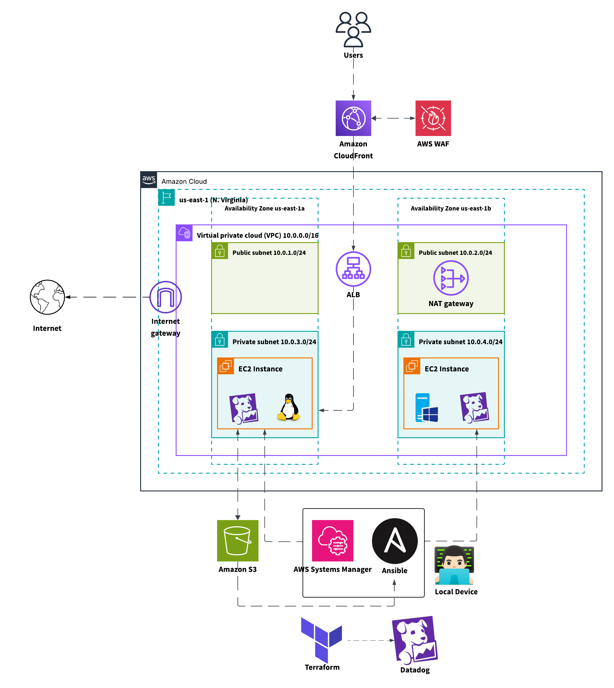

*Figure 1 — AWS architecture overview. One Linux and one Windows EC2 instance are drawn to illustrate placement; the Datadog monitoring scope described in this POC is ten EC2 instances in total.*

### 🌐 2.1 Networking and workload placement

The VPC is structured around two Availability Zones. Ingress and outbound connectivity components reside in the public tier; application EC2 workloads sit in private subnets.

| Component | Architecture detail |
| --- | --- |
| VPC | `10.0.0.0/16`, across two Availability Zones |
| Public subnet — AZ A | `10.0.1.0/24` |
| Public subnet — AZ B | `10.0.2.0/24` |
| Private subnet — AZ A | `10.0.3.0/24` |
| Private subnet — AZ B | `10.0.4.0/24` |
| Internet Gateway | Internet access for the VPC's public routing path |
| NAT Gateway | Outbound internet access from private instances through the public tier |
| Application Load Balancer | Public entry point for origin requests forwarded by CloudFront |
| EC2 | Application workloads located in private subnets |

**Why this design?** It separates public-facing application entry points from private compute resources, while allowing private instances to make necessary outbound connections through NAT.

### 🛡️ 2.2 Edge delivery and geographic access filtering

The inbound request path is:

**Users → CloudFront + AWS WAF → ALB → private EC2 web workload**

- **CloudFront** is configured with the **ALB as its origin**, providing an edge delivery layer for the web application.
- **AWS WAF** is associated with the CloudFront distribution.
- The documented WAF **geo-match rule (priority 0)** blocks requests whose source IP geolocates to a country **other than Egypt (`EG`)**.
- Requests that pass WAF evaluation can proceed to the origin, subject to any other access rules and application behavior.

This gave me a practical way to demonstrate request filtering before traffic reaches the application. IP geolocation is not a guarantee of a user's physical location, and protecting CloudFront does not by itself prevent direct access to a publicly reachable ALB origin; origin protection would need separate verification.

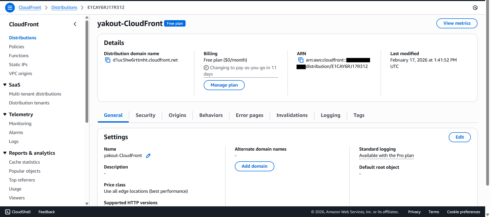

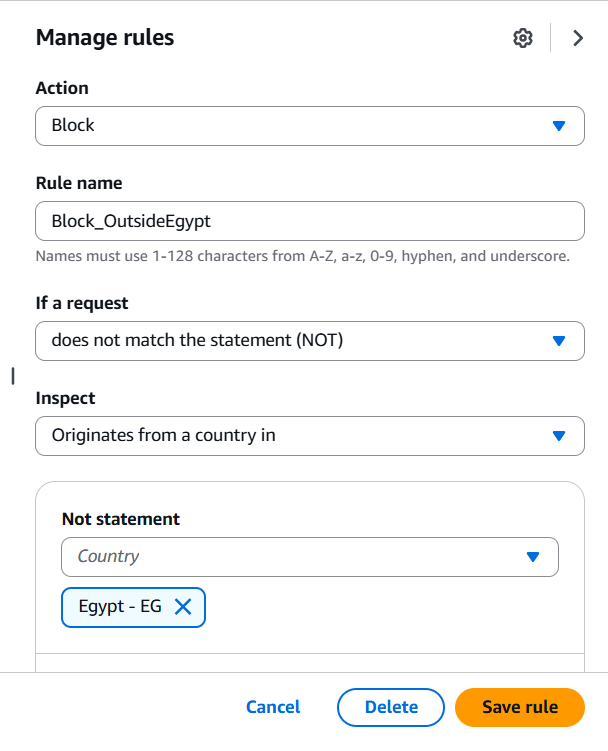

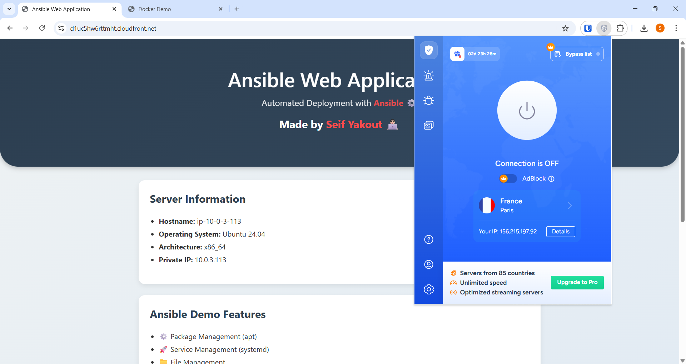

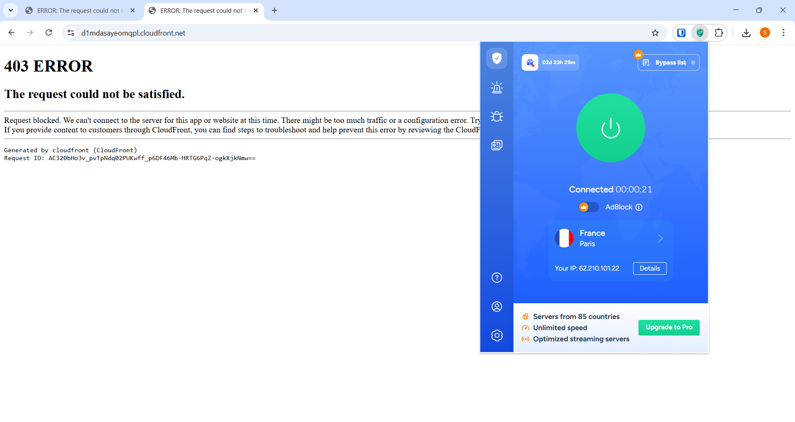

### ⚖️ 2.3 Load balancing and application ports

The ALB forwards requests to target groups for the web workloads. The original implementation notes describe two application endpoints on the primary Ubuntu host:

| Workload | Port | Purpose |
| --- | --- | --- |
| Apache2 running on the Ubuntu host | `80` | Website generated from a Jinja2 template and deployed using Ansible |
| Dockerized Nginx website | Host `8080` → container `80` | Separate container-based website |

These are the documented **service ports**. The exact listener rules, target-group mapping, and CloudFront behaviors were not supplied, so they are not represented as verified configuration details here.

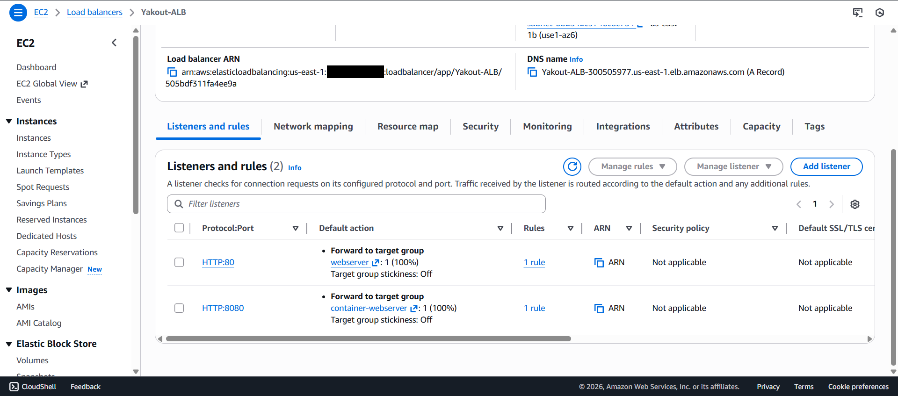

## 🖥️ 3. Application hosting — two approaches on Ubuntu

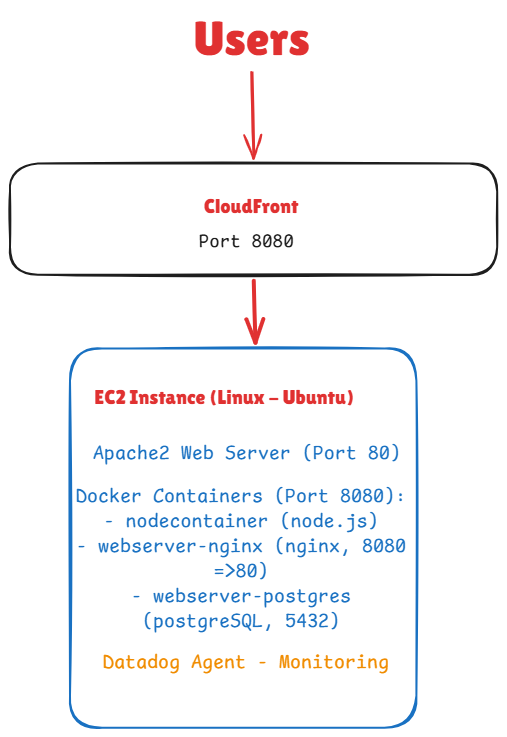

*Figure 2 — Component-level view of the Ubuntu/Windows environment, web server ports, Dockerized services, Datadog, and supporting automation tools.*

A central objective was to run two web-delivery approaches on an Ubuntu EC2 instance: a **host-managed website** and a **containerized application**.

### ⚙️ 3.1 Apache2 Website deployed with Ansible and Jinja2

For the host-based website, Ansible automated the configuration and deployment steps. The original notes refer to the playbook **`deploy-webservers.yml`**.

**Deployment flow:**

1. Ansible performs the web server deployment and configuration tasks on Ubuntu.
2. A **Jinja2 template** supplies the parameterized HTML content.
3. Ansible renders and deploys the generated webpage.
4. **Apache2 serves the website on port 80**.

**Important technical distinction:** Jinja2 is the **templating engine used during deployment**; Apache is the **running web server**. I used this approach to practice repeatable application configuration rather than manually editing web pages on the instance.

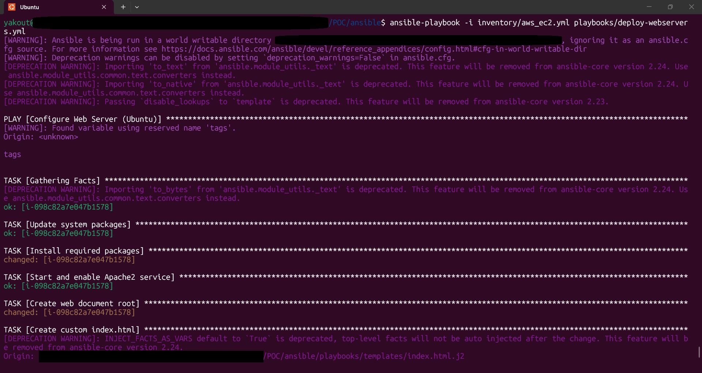

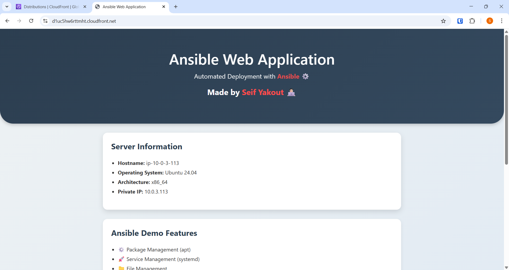

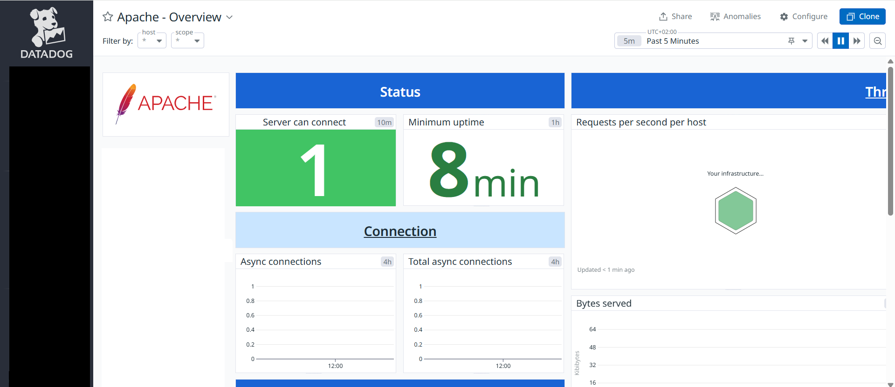

### 🐳 3.2 Dockerized Website using Nginx and Node.js

Alongside the Apache website, I maintained a separate website using a Docker-based stack. The supplied architecture identifies these components:

| Container / component | Role represented in the POC |
| --- | --- |
| `nodecontainer` | Node.js application container |
| `webserver-nginx` | Nginx web-facing container, with host `8080` mapped to container `80` |
| `webserver-postgres` | PostgreSQL container included in the application stack |

This setup let me compare **configuration-managed hosting** (Apache on the EC2 host) with **containerized service delivery** (Docker, Nginx, and Node.js). It also provided two distinct application endpoints for validation.

The original drawings do not establish the exact reverse-proxy rules, database persistence, container network configuration, or image versions; this case study therefore does not claim those details.

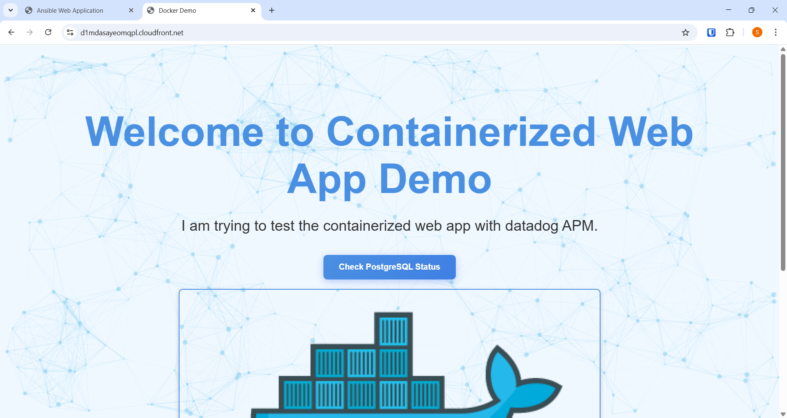

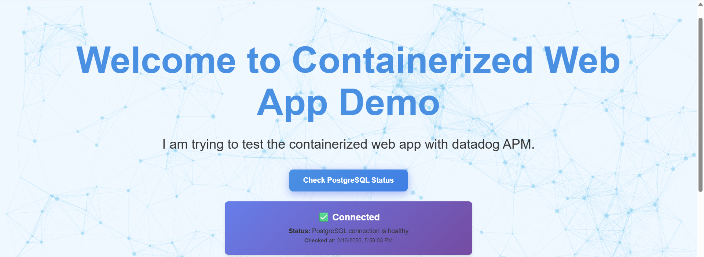

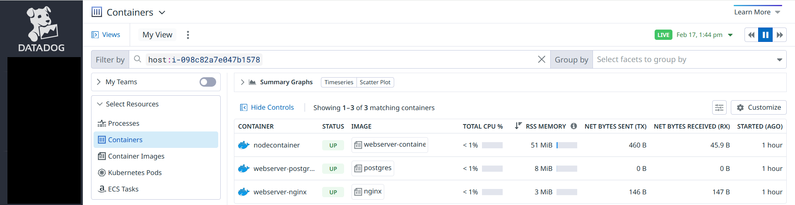

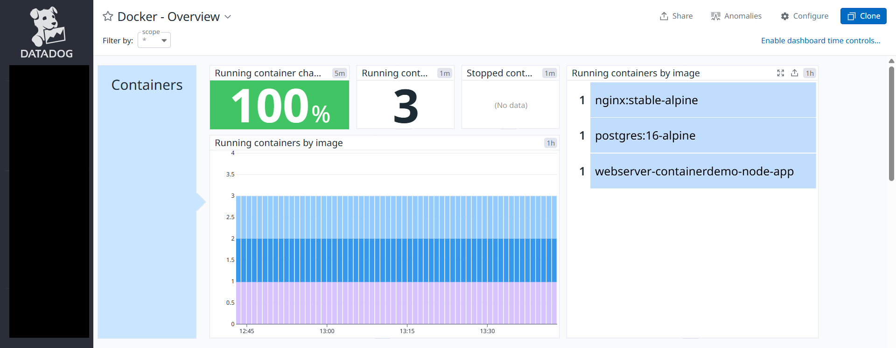

## 🤖 4. Operational Automation — Ansible, Systems Manager, and S3

In addition to the application components, the architecture includes a local management machine, **Ansible**, **AWS Systems Manager**, and **Amazon S3**.

- **Ansible** is the configuration-management and application-deployment tool used for the Ubuntu website, as well as automated Datadog Agent installation across Windows Server and Ubuntu.
- **AWS Systems Manager** is included as part of the instance-management and automation design.
- **Amazon S3** is shown as a temporary staging location for transferring Ansible modules.
- The **local device** represents the management side of the workflow.

This highlights the difference between the **application request path** and the **operations path**: administrators and automation tools manage workloads separately from the visitors accessing the websites. The available notes do not establish an exact Systems Manager connection method or IAM configuration, so those specifics are intentionally not asserted.

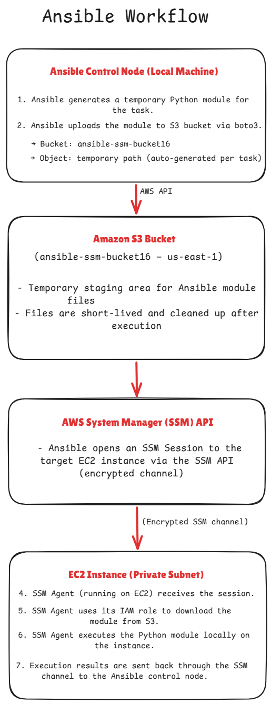

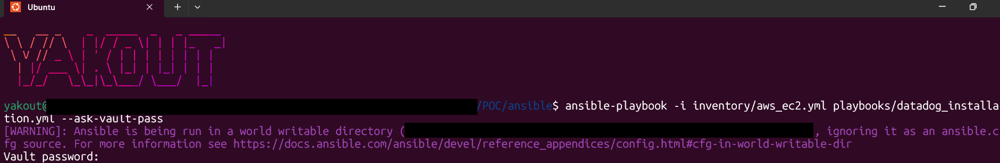

## 📊 5. Datadog — One monitoring platform for Windows and Linux

The monitoring portion of this POC focuses on a mixed fleet of **ten Amazon EC2 instances**.

| Operating system | EC2 instances | Monitoring component |
| --- | ---: | --- |
| Windows Server | **5** | Datadog Agent |
| Ubuntu Linux | **5** | Datadog Agent |
| **Total** | **10** | **Unified Datadog host visibility** |

I used **Ansible to automate Datadog Agent installation on both Windows Server and Ubuntu** to bring infrastructure telemetry into the same observability platform. This POC illustrates an operational requirement common to real environments: **monitoring different hosts consistently**, despite platform differences in agent installation and service management.

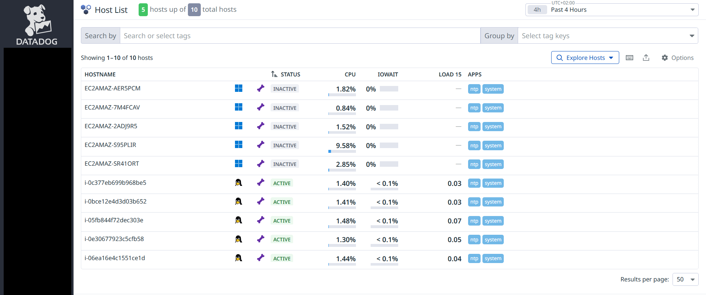

## 🧱 6. Terraform — Automating Datadog monitors and dashboards

Agent installation was only one part of the monitoring exercise. I also used **Terraform** to automate creation of **Datadog monitors and a dashboard**.

The workflow is conceptually separated into two areas:

- **Telemetry collection:** Datadog Agents run on the Windows and Ubuntu EC2 machines and report host monitoring data to Datadog.
- **Monitoring configuration:** Terraform provisions Datadog monitoring resources, making monitors and a dashboard reproducible rather than dependent only on manual creation in the Datadog console.

**Why Terraform matters here:** It demonstrates **observability as code**, in addition to application automation with Ansible. The repository intentionally focuses on the implemented capability rather than publishing Terraform files, provider credentials, monitor queries, thresholds, or dashboard definitions.

## 🔄 7. End-to-End Flows

| Flow | Components | What the POC demonstrates |
| --- | --- | --- |
| Web requests | User → CloudFront/WAF → ALB → EC2 | An edge-filtered entry path to hosted websites |
| Private-instance egress | Private EC2 → NAT Gateway → internet | Outbound connectivity design for non-public instances |
| Host-based deployment | Ansible + Jinja2 → Apache2 | Repeatable deployment of a templated website |
| Container-based deployment | Docker → Nginx/Node.js website | Containerized hosting alongside the Apache site |
| Multi-OS monitoring | Ansible → 5 Windows + 5 Ubuntu → Datadog | Automated Agent installation and common monitoring for heterogeneous hosts |
| Monitoring automation | Terraform → Datadog monitors/dashboard | Reproducible monitoring configuration |

## 🎯 8. Engineering Takeaways

**What I practiced:**

- **AWS architecture and security:** edge filtering, subnet segregation, load balancing, and private workloads.
- **Configuration management:** repeatable website deployment using Ansible and Jinja2.
- **Containers:** operating a Dockerized web stack alongside a host-installed Apache service.
- **Cross-platform observability:** automating Datadog Agent installation with Ansible and managing monitoring across Windows Server and Ubuntu.
- **Infrastructure as code for observability:** creating Datadog monitors and a dashboard through Terraform.

## 💬 9. Final Thoughts & Let's Connect

I really enjoyed building this POC because it gave me the opportunity to explore and connect different areas of **AWS architecture, automation, containerization, and observability** in one hands-on environment. It was a great learning experience to see how these technologies work together.

If you have any questions, would like me to explain part of the implementation, or want to exchange ideas, **feel free to reach out**. I'd be happy to connect and help where I can!
